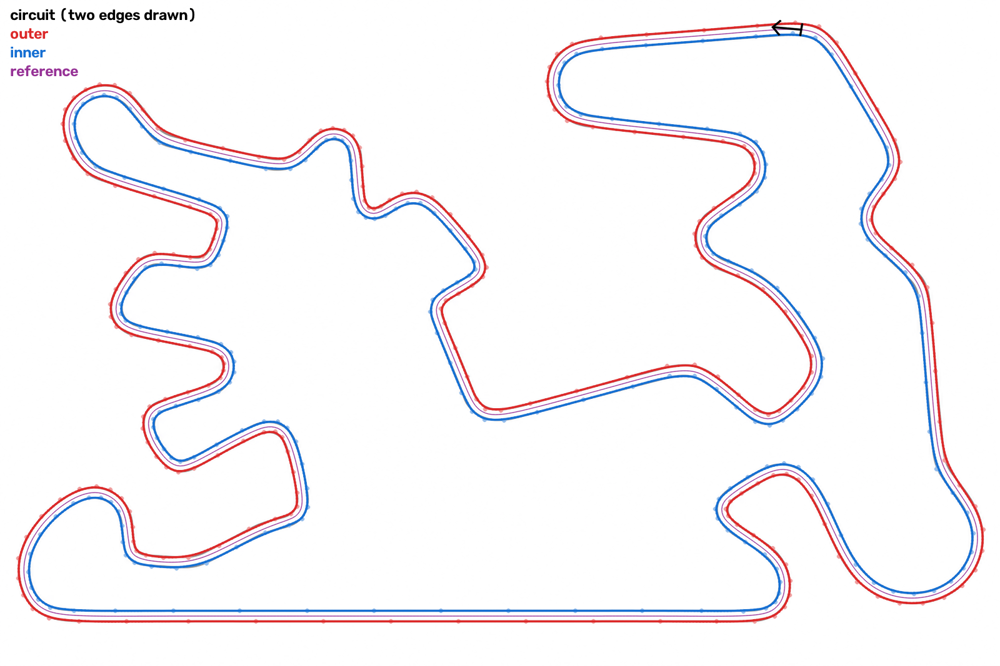
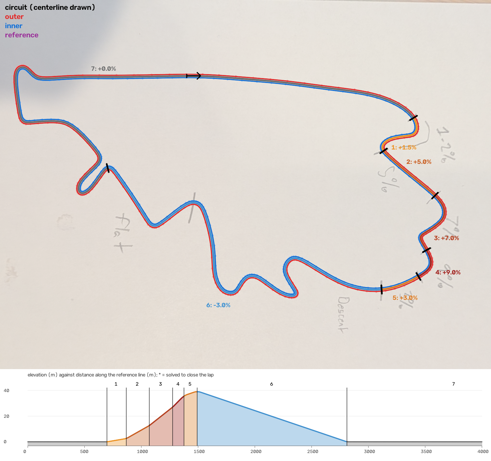
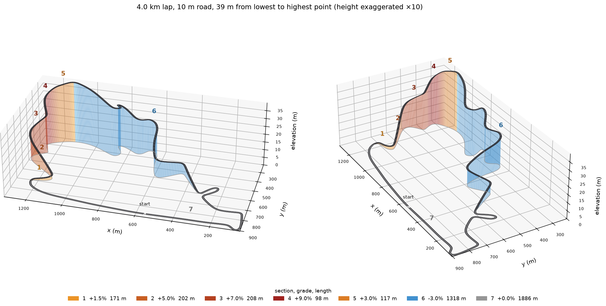
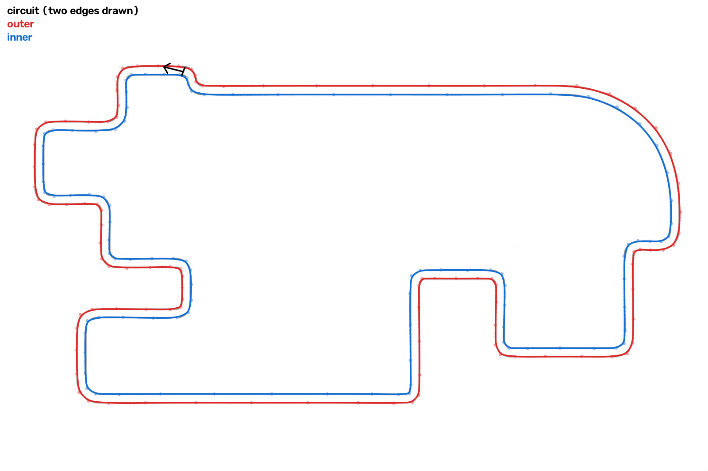
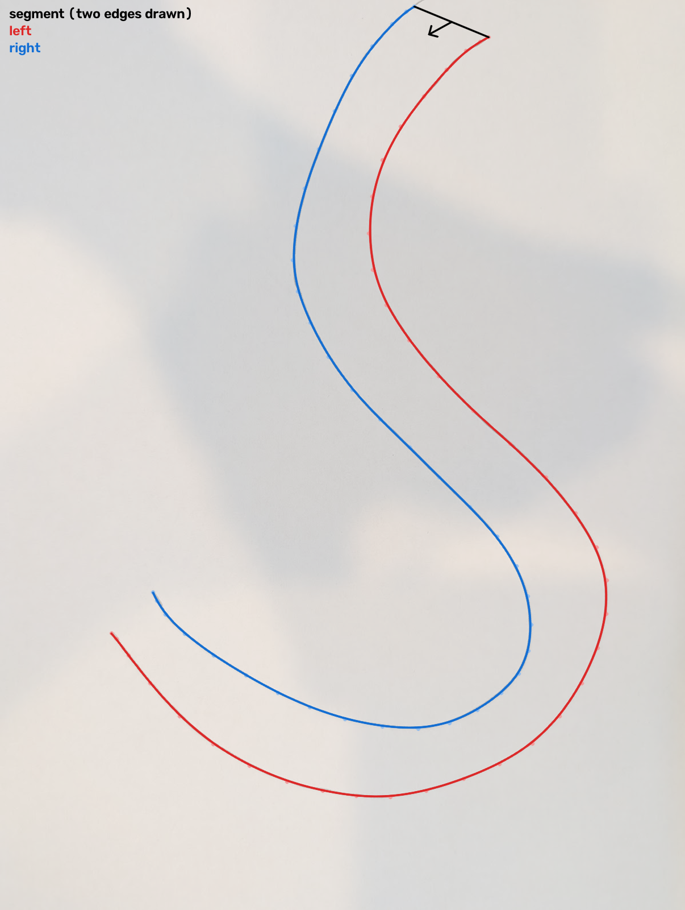

# drawcircuit

Turn a photo or scan of a hand-drawn race track into B-spline curves for the
two track edges.

- Works with pencil or pen on plain paper. It copes with uneven lighting, hard
  shadows, gaps in the line, and a sheet photographed at an angle on a table.
- Tells a **full circuit** (closed loop) apart from a **segment** (open piece of road).
- Accepts either drawing style:
  - **both edges drawn** (two lines): fits each edge directly
  - **one line drawn** (the centerline): fits it and offsets it by a road width
- Writes cubic B-splines (knots plus control points) as JSON, plus an overlay
  PNG for checking the result.
- For circuits, also writes a smooth **reference line** with the road width to
  either side measured along its normal: the input a racing-line optimiser
  works from (x, y, w_left, w_right).
- Takes a **real-world scale**: give the lap length in meters (and, for a
  centerline drawing, the road width in meters).
- Reads **grade marks**: short ticks drawn across a centerline split the lap
  into sections. Give each section's grade and it writes an elevation profile,
  and `drawcircuit-3d` draws the circuit in 3D.







`examples/` holds the test drawings with their JSON and overlays: two pencil
photos with shadows (`s_curve_photo`, and `hand_drawn_circuit` whose road
deliberately bulges to twice its width on one side), and six clean digital
circuits with a narrow road (`complex_circuit`, `flowing_circuit`, `street_circuit`,
`hairpin_circuit`, `s_bend_circuit` and `diagonal_circuit`, the last four with sharp corners).
`climb_circuit`, `switchback_circuit` and `wide_straight_circuit` are pencil
photos of circuits drawn as one line, with ticks and the grades written beside
them, processed as 4, 5 and 2 km laps with a 10 m road; the last one has a
20 m wide start straight and street-style climbs that change grade within a few
meters (see [Grades and scale](#grades-and-scale)):

```sh
uv run drawcircuit examples/climb_circuit.jpg --direction cw --length-m 4000 --track-width-m 10 \
    --grades "1-2%,5%,7%,9%,3%,-3%,flat" --move-tick 7
uv run drawcircuit examples/switchback_circuit.jpg --direction cw --length-m 5000 --track-width-m 10 \
    --grades "2%,6%,5%,7%,5%,flat,descent,flat,1%"
uv run drawcircuit examples/wide_straight_circuit.jpg --direction cw --length-m 2000 --track-width-m 10 \
    --section-width-m 11=20 --grades "flat,12%,flat,-5%,flat,2%,-2%,flat,12%,-4%,flat" \
    --move-tick 11 --vertical-radius-m 100   # punchy street climbs: sharp grade changes
```

## Driven by an LLM

drawcircuit is meant to be run by an LLM (such as Claude Code) on the user's
behalf, with the photo in front of it. The work is split accordingly:

- **The program measures.** Whatever needs pixel accuracy: finding the ink,
  tracing the lines, fitting splines, the reference line and road widths,
  where tick marks cross the line, the scale and the elevation profile.
- **The LLM reads and decides.** Whatever needs reading or judgment: the
  handwritten grades and labels, which way the circuit runs, what a mark
  means, and what the user wants changed ("make the descent 3%"). It passes
  them as options (`--grades`, `--direction`, `--move-tick`, `--length-m`, ...)
  and checks the result in the printed summary, the overlay and the 3D view.

So the program has no handwriting recognition or label parsing, and new
features take the form of explicit, general options rather than more
heuristics for reading the drawing. A typical session: the user shares a
photo and says "make this a 4 km circuit with a 10 m road"; the LLM runs
`drawcircuit` once to see the numbered sections, reads the grades and the
direction off the photo, runs it again with `--grades` and `--direction`, and
renders `drawcircuit-3d` to check.

## Install and run

```sh
uv sync
uv run drawcircuit sketch.jpg              # writes sketch.track.json and sketch.overlay.png
uv run drawcircuit sketch.jpg --debug-dir dbg   # also writes every intermediate stage
uv run drawcircuit sketch.jpg --direction cw --length-m 4000 --track-width-m 10 \
    --grades "1%,5%,descent,flat"            # real scale and grades
uv run drawcircuit-3d sketch.track.json    # writes sketch.3d.png
```

The CLI prints what it found:

```
circuit: two drawn edges -> edges outer, inner
  outer   223 control points, length  8048.7 px, fit error max 3.53 px
  inner   223 control points, length  7938.1 px, fit error max 2.92 px
  track width ~17 px (min 15, max 19)
  reference line 7990.5 px, min radius 18.4 px, 1 - w*kappa >= 0.54, within 0.5 px of the midline
```

From Python:

```python
from drawcircuit import process, Params

result = process("sketch.jpg", Params())
track = result.track
track.kind            # "circuit" or "segment"
track.source          # "edges" (two lines drawn) or "centerline" (one line drawn)
outer = track.edges["outer"]       # circuits: "outer"/"inner", segments: "left"/"right"
outer.sample(500)                  # (500, 2) points
outer(0.25), outer(0.25, nu=1)     # position and derivative at a parameter value
outer.knots, outer.control_points, outer.degree
track.left_edge, track.right_edge  # e.g. "inner", "outer": which edge is on the left in the direction of travel
ref = track.reference              # circuits only, else None
ref.line                           # the reference line, a Spline
ref.s, ref.u, ref.w_left, ref.w_right   # one row every 2 px of arc length

result = process("climb.jpg", Params(direction="cw", length_m=4000, track_width_m=10,
                                     grades=["1-2%", "5%", "7%", "9%", "3%", "descent", "flat"]))
result.track.m_per_px              # meters per px, when length_m is given
prof = result.track.profile        # circuits drawn as a centerline with tick marks, or given grades
prof.ticks, prof.sections          # tick positions (s along the reference line) and the sections between them
prof.z, prof.grade                 # elevation (px) and grade at each reference row
```

## Output format (`*.track.json`)

```jsonc
{
  "type": "circuit",            // or "segment"
  "source": "edges",            // "edges": two edges drawn; "centerline": one line drawn and offset
  "direction": "ccw",           // circuits only: travel direction as seen on the page
  "left_edge": "inner",         // the edge on the left in the direction of travel
  "right_edge": "outer",
  "frame": {                    // coordinate system of every point below
    "width": 1600, "height": 1236, "units": "px", "y_axis": "down",
    "paper_detected": true,     // the sheet was found in the photo and straightened
    "input_to_frame": [[...]]   // 3x3 homography, input image px -> frame px
  },
  "track_width_px": {"median": 70.2, "min": 67.9, "max": 73.4},
  "edges": {
    "outer": {                  // circuits: outer/inner, segments: left/right
      "degree": 3,
      "periodic": true,         // true for circuits
      "domain": [0.0, 1.0],
      "knots": [...],           // len(knots) == len(control_points) + degree + 1
      "control_points": [[x, y], ...],
      "length_px": 3391.7,
      "fit_error_px": {"rms": 0.5, "max": 1.1},
      "samples": [[x, y], ...]  // the curve sampled evenly in parameter
    },
    "inner": {...}
  },
  "centerline": null,           // the fitted centerline when source == "centerline"
  "reference": {                // circuits only, else null
    "line": {...},              // closed spline, same fields as an edge
    "smoothing_sigma_px": 7.68, // Gaussian smoothing applied to the true midline
    "max_midline_deviation_px": 2.461,
    "min_radius_px": 16.07,
    "min_1_minus_w_kappa": 0.373, // min over the lap of 1 - w_inside * |curvature|
    "spacing_px": 1.999885,   // lap length / number of rows, about 2 px
    "columns": ["s_px", "u", "w_left", "w_right"],
    "rows": [[0.0, 0.0, 10.144, 10.137], [2.0, 0.0004175, 10.144, 10.137], ...]
  },
  "scale": {                    // null unless the real length was given
    "m_per_px": 0.910230618, "length_m": 4000.0, "track_width_m": 10.0
  },
  "profile": {                  // null unless tick marks were found or grades given (circuits only)
    "vertical_radius_px": 1098.623,  // of the curves that ease each grade change
    "ticks": [                  // where each tick crosses the reference line
      {"s_px": 766.086, "point": [1347.262, 384.545], "ease_px": 16.479, "moved_px": 0.0}, ...
      // ease_px: length of its vertical curve; moved_px: shift by --move-tick from where it is drawn
    ],
    "sections": [               // in travel order; section 1 starts at the first tick after the start
      {"index": 1, "label": "1-2%", "grade": 0.015, "solved": false,
       "s_start_px": 766.086, "s_end_px": 954.107, "length_px": 188.021,
       "width_px": 10.989, "z_start_px": 0.031, "z_end_px": 2.989}, ...
    ],
    "columns": ["s_px", "z_px", "grade"],
    "rows": [[0.0, 0.0, 0.0], [2.0, 0.0, 0.0], ...]  // one per reference row; [] until grades are given
  },
  "warnings": []
}
```

**The reference line.** Racing-line optimisers describe the road as a smooth
reference line plus the width to either side of it. `reference.line` is a
closed spline between the edges that starts beside their start and runs in
the direction of travel. Each row gives the arc length `s_px` along the line, its
parameter `u`, and the distances `w_left`, `w_right` (both positive) from the
point `line(u)` to the `left_edge` and `right_edge`, measured along the line's
normal. So `line(u) + w_left * n` lies on the left edge and `line(u) - w_right * n`
on the right edge, where `n` is the unit normal pointing to the left.

The line is the true midline (the points equally far from both edges),
smoothed just enough that `1 - w_inside * |curvature| >= 0.3` everywhere, where
`w_inside` is the width on the side the line turns towards. Where that factor
reaches 0, the normals of neighbouring points cross inside the road. Sharp
corners need the smoothing: it widens them and moves the line towards their
inside. The edges are left exactly as drawn.

**Evaluating the splines.** Each spline is a standard B-spline: any de Boor
evaluator gives the curve for u in `domain`, which is [0, 1]. The parameter is
roughly proportional to arc length. Knots are not evenly spaced: they are
packed into corners and spread out on straights.

- **Segments (open curves)** use clamped knots, so they start and end exactly at
  their first and last control points.
- **Circuits (closed curves)** use a periodic knot vector, where `t[i + n] = t[i] + 1`
  for `n` distinct control points. The last `degree` control points repeat the
  first ones, which makes the curve continuous in position, tangent and
  curvature where the loop joins.

`scipy.interpolate.BSpline(t, c, k)` evaluates both kinds directly; for
circuits pass `extrapolate="periodic"`.

**Conventions.**

- Circuits run counter-clockwise on the page by default (`--direction cw` to flip).
  Seen in the direction of travel, the inner edge is then on the left.
  `left_edge` and `right_edge` name the edges on each side.
- Circuits start halfway along their longest straight, with both edges side by
  side. A straight is the longest stretch that turns by less than 10° (measured
  over ~15 px, so hand jitter does not count). A track without straights starts
  on its least curved stretch.
- Segments start at the end nearer the top-left of the page. `left` and `right`
  are relative to that direction of travel.
- Coordinates are pixels of the working frame: the straightened sheet (or the
  whole image), scaled so its long side is `--working-size` (default 1600).
  The y axis points down. If you need y up, flip it as `y' = height - y`.
  With `--length-m`, multiply by `scale.m_per_px` for meters.

## Grades and scale

**Scale.** `--length-m 4000` makes the lap 4000 m long, measured along the
reference line (a segment's length is measured along its centerline, or the
mean of its edges). Everything in the JSON stays in pixels; `scale.m_per_px`
converts. For a centerline drawing, `--track-width-m 10` sets the road width
in meters instead of pixels. The road width changes the reference line and
so the lap length in pixels, so the track is rebuilt until both match (once
or twice).

**Road widths.** A centerline drawing's road can change width from section to
section: `--section-width-m 11=20` makes section 11 20 m wide and the rest
`--track-width-m` wide (repeat it for more sections). Each change is spread
smoothly over 5 times its size, centred on the tick (`--width-taper`), so 10 m
to 20 m takes 50 m. The CLI lists each section's width and the JSON gives it
as `width_px`; the reference rows' `w_left` and `w_right` follow it.

**Ticks.** On a circuit drawn as one line, short marks drawn across the line
split it into sections. A tick may cross the line or touch it from one side.
Section 1 starts at the first tick after the start line, and the last section
runs through the start line back to the first tick. The overlay numbers the
sections, and the CLI lists them, so a first run without `--grades` shows the
order to list the grades in.

**Grades.** `--grades` lists one grade per section, in travel order, separated
by commas. A grade is rise over horizontal run in percent: `5%` or `5`, `-3%`,
`flat`, or a range such as `1-2%`, which takes its midpoint. `descent`,
`climb` or `?` leave the grade open: those sections share the one grade that
brings the lap back to the height it started at, and the CLI marks them as
solved. The elevation `z` is 0 at the start line and rises at each section's
grade. It is in pixels like `s`; multiply by `m_per_px` for meters.

**Moving a tick.** To set a section's average grade instead of solving it,
give every section a grade and let one tick move: `--move-tick K` slides tick
K along the lap until the lap closes. `--grades "...,3%,-3%,flat" --move-tick 7`
makes the descent 3% and as long as the climb needs, at the expense of the
flat section after it. The CLI reports how far the tick moved, the overlay
draws it where it ends up, and `profile.ticks[k].moved_px` records the shift.

**Easing.** The grade does not jump at a tick. It changes at a steady rate
along a parabolic vertical curve centred on the tick, as on a real road:
`--vertical-radius-m` (default 1000 m) is the curve's radius, so a change
from 3% to −4% takes 70 m and one from 7% to 9% takes 20 m. Outside the
curves the elevation is that of the plain grades, so the lap still closes;
on the curves a crest is rounded down and a dip filled in, by at most
`change × length / 8` (0.45 m at the top of `climb_circuit`). A curve is never
longer than either section beside it, so very short sections get a tighter
curve (with a warning). Without `--length-m`, the radius is a quarter of the
lap. For short, steep street climbs use a small radius, e.g. 100 m (an 8% kick
then starts within 8 m); `--vertical-radius-m 0` gives abrupt changes.

The program does not read handwriting: the LLM driving it reads the grades
off the photo and passes them with `--grades` (see [Driven by an LLM](#driven-by-an-llm)).
Positive grades climb in the direction of travel, so set `--direction` to match
the order the grades were written in. For
`climb_circuit`, which climbs 1-2%, 5%, 7%, 9% and 3% before the descent,
that is clockwise. As drawn, the descent would average 4.1% (`descent` in
place of `-3%`, without `--move-tick`); moving its end makes it 3%:

```
circuit: drawn centerline -> edges outer, inner
  ...
  scale 0.9102 m/px: 4000 m long, road 10.0 m wide
  7 tick marks -> 7 sections in travel order (section 1 starts at the first tick after the start line):
  tick 7 moved +364 m along the lap from where it is drawn, so the grades close the lap
     1     171 m   +1.50%  1-2%
     2     202 m   +5.00%  5%
     3     208 m   +7.00%  7%
     4      98 m   +9.00%  9%
     5     117 m   +3.00%  3%
     6    1318 m   -3.00%  -3%
     7    1886 m   +0.00%  flat
  grade changes eased on a 1000 m vertical radius, over 15 to 60 m around each tick
  elevation +0.0 to +39.1 m relative to the start line, total climb 39.1 m
```

**3D view.** `drawcircuit-3d track.json` draws a circuit from its JSON in 3D:
the road at its elevation over a curtain coloured by grade, with heights
exaggerated so the height range looks about 0.3 times the track's size
(`--exaggeration` to set it; 10 for `climb_circuit`). `--view AZIM,ELEV` picks the
viewpoint in degrees; repeat it for several views side by side.

## How it works

1. **Page.** If the photo shows a sheet on a darker surface, the sheet's four
   corners are found and the image is straightened. A sunlit patch between
   shadows is not mistaken for the sheet: the sheet must be convex, have four
   corners, and be clearly brighter than its surroundings.
2. **Ink.** The local paper brightness is estimated with a morphological
   closing. This removes thin dark lines but keeps the sharp edges of shadows.
   Each pixel's ink strength is how much darker it is than its local paper.
   Thresholds are set in units of the *local* noise level, because shadows are
   noisier. A ridge filter adds faint pencil lines, since it gathers evidence
   along the line the way the eye does.
3. **Skeleton.** The ink is thinned to a one-pixel skeleton and short spurs are
   pruned. The skeleton is split into paths at junctions and at sharp corners.
4. **Strokes.** Paths are joined end to end, cheapest join first. The cost
   favors short gaps and straight continuation. A long gap is bridged only if
   both ends line up along a smooth arc and the pieces on either side are real
   lines rather than small marks. This bridges pencil skips, passes straight
   through crossings (a start/finish line, a figure-8), and ignores scribbles.
   A stroke whose ends join becomes a loop. Before joining, a short straight
   dead end that leaves a line steeply (a tick drawn on one side) is dropped
   and the line is joined through, even where it turns sharply right there.
5. **Layout.** Long strokes are candidate track lines. Two strokes that run
   alongside each other at a steady distance count as the edges: two nested
   loops make a circuit, two open lines make a segment. Otherwise the longest
   stroke is taken as a centerline.
6. **B-splines.** Each line is fitted with a penalized least-squares cubic
   B-spline. Knot density follows the curve's turning (measured over ~8 px so
   hand jitter does not count): `--cp-spacing` apart on straights plus 4 per
   radian of turning. Fitting starts sparse and adds knots until 98% of the
   line is within `--tol` pixels, so a looser tolerance gives fewer control
   points. For a centerline, the edges are offset by half the road width along
   the normal and then fitted to within 0.5 px, so the road is as wide as asked.
7. **Reference line.** For circuits, the true midline is traced as the zero
   level of (distance to outer edge − distance to inner edge). It is smoothed
   with a Gaussian of growing width (from 2 px, ×1.4 per step) until the
   condition above holds, then fitted. The widths are found by casting rays
   along the line's normals onto the edges.
8. **Ticks.** For a centerline, ink more than half a stroke width from the
   drawn line is grouped into pieces. A piece that touches the line, reaches
   1.5 stroke widths to 100 px from it, is straight and leaves the line at 45° or
   more is (half of) a tick. Spur pruning removes short ticks from the
   skeleton, which is why this looks at the ink. Each tick is placed where its
   axis crosses the line, then moved to the reference line.

## Options

| option | default | meaning |
|---|---|---|
| `--mode auto\|edges\|centerline` | auto | what was drawn |
| `--circuit` / `--segment` | detect | force a closed circuit / never close a stroke into a loop |
| `--track-width PX` | 3.5% of the diagonal | road width for centerline drawings |
| `--length-m M` | | real length of the lap in meters; sets `scale.m_per_px` |
| `--track-width-m M` | | road width in meters for centerline drawings (needs `--length-m`) |
| `--grades LIST` | | grades of the sections between ticks, in travel order, e.g. `"1-2%,5%,descent,flat"` |
| `--section-width-m K=W` | | road width W in meters for section K of a centerline circuit; repeatable |
| `--width-taper X` | 5 | a change of road width is spread over X times its size |
| `--move-tick K` | | move tick K along the lap until the grades, all given, close it |
| `--vertical-radius-m M` | 1000 | radius of the vertical curves that ease grade changes (needs `--length-m`; 0 = abrupt) |
| `--direction ccw\|cw` | ccw | travel direction for circuits |
| `--tol PX` | 2.5 | how closely the spline follows the drawn line (bigger = smoother, fewer control points) |
| `--cp-spacing PX` | 60 | control point spacing on straights |
| `--smooth X` | 0.05 | control polygon smoothing penalty |
| `--max-gap PX` | 120 | longest break in a line that can be bridged |
| `--ink-threshold X` | auto | manual ink threshold (0..1) if detection misbehaves |
| `--no-paper` | | do not look for a sheet to straighten |
| `--working-size PX` | 1600 | long side of the output frame |
| `--samples N` | 256 | sampled points per curve in the JSON |
| `--debug-dir DIR` | | write the stage images (`1_page` … `6_result`) |

## Drawing tips

- Draw on plain, unlined paper. Firm pencil or pen works best, but faint lines
  usually work too.
- Draw each edge as one continuous line where you can. Small skips are fine.
- Labels, arrows and start/finish lines are fine. Keep labels from touching the
  track lines.
- To mark grades on a centerline, draw a short straight tick across the line
  (or touching it from one side) at each change, and write the grades clear of
  the line. A start/finish line drawn across a centerline also counts as a tick.
- Leave about a pencil width of space between the two edges. Where the edges
  touch, the program has to guess which line is which.
- Photograph from roughly above. Shadows are fine. A darker table around the
  sheet lets the sheet be found and straightened.

## Limitations

- Figure-8 tracks work when drawn as a centerline. Drawn with two edges, the
  edges cross at the bridge and the drawing is misread as a centerline circuit
  (with a warning). Use `--mode edges` to get an error instead of a wrong guess.
- A segment drawn as a closed outline (both edges plus the two end caps) is
  taken as one closed line, so it is misread as a centerline circuit. Leave
  the ends of a segment open.
- A centerline's road width is constant within each section (`--track-width`,
  or `--track-width-m` and `--section-width-m`), apart from the tapers.
- Only circuits get a reference line. A figure-8 does not get one, since its
  edges cross.
- Output is in pixels. Real-world scale comes from `--length-m`, not from the
  paper size.
- Handwriting is not read, by design: the LLM driving the program passes the
  grades with `--grades`. Grades are only supported on circuits drawn as a centerline (ticks across two drawn edges
  are not looked for).

## Development

```sh
uv run pytest                                  # unit + end-to-end tests on synthetic sketches
uv run python -m drawcircuit.synth out_dir     # write synthetic example sketches
```

`drawcircuit.synth` renders pencil-like sketches with known ground truth:
wobbly strokes with gaps, pencil grain, uneven light, hard shadows, scribbles,
start lines, and perspective photos of a sheet on a table. The tests check
classification and fit accuracy against that ground truth.
